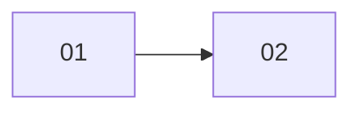

# <name>: <short title>

> Created YYYY-MM-DD · Last update YYYY-MM-DD

## Summary
<What the feature is and why, in 2–3 lines.>

## Links
- Jira: <story / epic>
- Repos: <repo name → path>
- Branches / PRs: <list>

## Rules
- 25 or fewer changed files per PR.
- Every code step includes tests; mocks use Builder / ObjectMother classes in `__mocks__` (`dehv-ui-mock-data`, `dehv-ui-unit-tests`).
- Commit messages proposed with `dehv-commit`.
- No commit, push, merge or PR without confirmation.
- One step = one PR: <yes / no / per step>.

## Decisions
| Date | Decision | Why |
| --- | --- | --- |

## Overview

## Steps
| # | Step | Status | PR / Ticket | Updated |
| --- | --- | --- | --- | --- |
| 01 | [<step title>](steps/01-<slug>.md) | NotStarted | | |

## Values
| Key | Value | Step |
| --- | --- | --- |
| Plan folder | <plans_dir>/<name>/ | |
| App URL | <url used for screenshots, if any> | |

## Log
- YYYY-MM-DD: plan created.
